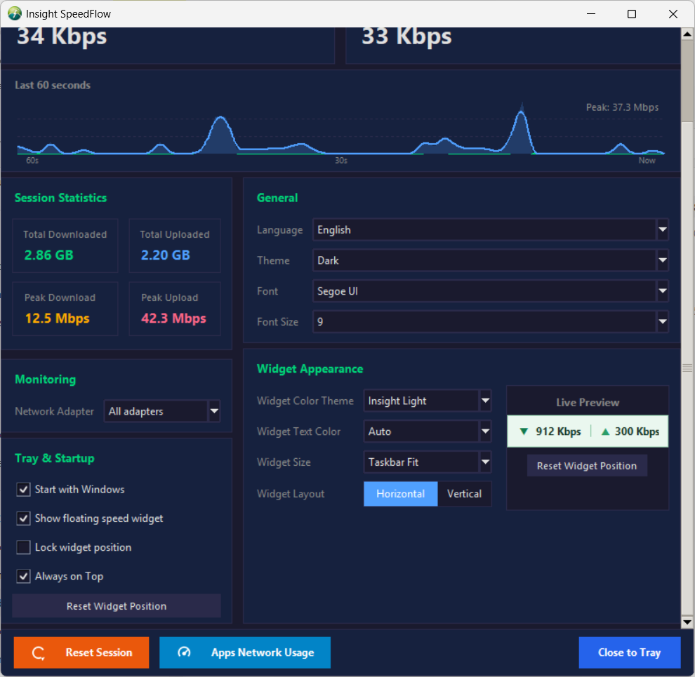
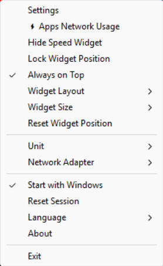

<div align="center">


# ⚡ Insight SpeedFlow
### Real-Time Network Speed & Telemetry Monitor for Windows
**Version 1.12 — Fast, Lightweight & Accurate**

[](https://github.com/alarifi/insight-speedflow/releases/tag/v1.12)
[-00a4ef.svg?style=for-the-badge&logo=windows)](https://github.com/alarifi/insight-speedflow)
[](https://github.com/alarifi/insight-speedflow/releases/tag/v1.12)
[](https://www.insight-ye.com)

<p align="center">
  <b>برنامج احترافي خفيف لمراقبة سرعة الإنترنت والشبكة بالزمن الحقيقي مع ويدجت عائم ورسم بياني حي.</b><br>
  A modern, lightweight Windows utility providing continuous real-time network throughput monitoring, a floating desktop/taskbar widget, live wave telemetry, ping latency diagnostics, and session bandwidth tracking.
</p>

---

</div>

## 📸 Screenshots & Interface | واجهة البرنامج

<div align="center">

### 📊 Main Statistics & Telemetry Dashboard


<br/><br/>

| 🪟 Floating Desktop Widget | ⚙️ System Tray Menu |
| :---: | :---: |
|  |  |
| *ويدجت عائم شفاف وقابل للتثبيت قرب شريط المهام* | *قائمة وصول سريع وتخصيص فوري من التراي* |

</div>

---

## 🌟 Key Features | أهم المميزات

### 🇸🇦 المميزات الرئيسية (بالعربية)
- 🚀 **مراقبة حية بالثانية**: قراءة دقيقة وفورية لسرعات التنزيل (Download) والرفع (Upload).
- 🪟 **Floating Widget عائم وذكي**: ويدجت صغير وأنيق يطفو فوق النوافذ أو بجوار شريط المهام، قابل للسحب وحفظ الموقع، مع ميزة قفل الموقع (`Lock Widget`).
- 📈 **رسم بياني حي (Wave Telemetry Graph)**: يعرض تدفق البيانات لآخر 60 ثانية بنعومة ودقة متناهية.
- 🏓 **فاحص زمن الاستجابة (Ping Monitor)**: قياس البنج المباشر مع سيرفرات DNS العالمية (مثل Google DNS و Cloudflare) للتأكد من استقرار الخط.
- 📊 **إحصائيات الجلسة الشاملة**: حساب استهلاك البيانات الكلي منذ بدء التشغيل، ورصد أعلى سرعة قياسية مسجلة (Peak Speed).
- 🎨 **تخصيص كامل للشكل**: تحكم في الخطوط، أحجام الويدجت، لوحات الألوان (Dark / Modern Palettes)، وشفافية الواجهة.
- 🔄 **دعم كافة المحولات الشبكية**: التبديل الفوري بين WiFi و Ethernet و All Adapters.
- ⚡ **أداء خارق وخفيف جداً**: استهلاك شبه معدوم للمعالج (0% CPU idle) واستهلاك رام منخفض جداً لا يؤثر على الألعاب أو الأعمال الشاقة.
- 🪟 **التشغيل التلقائي**: إمكانية التشغيل الصامت مع بدء تشغيل الويندوز (Start with Windows).

### 🇬🇧 English Overview
- **Real-Time Throughput Telemetry**: Precision tracking of incoming and outgoing bandwidth updated every second.
- **Always-on-Top Floating Widget**: Sleek, customizable micro-widget positioned on your taskbar or anywhere on your desktop, with drag-and-drop and location lock.
- **Dynamic 60-Second Wave Graph**: Smooth graphical visualization of bandwidth spikes and consistency over time.
- **Latency Diagnostics (Ping)**: Continuous ping response measurement to ensure connection stability.
- **Session Totals & Peak Records**: Real-time accumulator showing total GB transferred and max throughput achieved during the current session.
- **Dual Display Units**: Seamless one-click toggling between **MB/s** (Megabytes) and **Mbps** (Megabits).
- **Zero Performance Impact**: Engineered in pure native routines for negligible CPU overhead and minimal RAM usage.
- **Single-Instance Safety**: Guarded startup prevents multiple background instances from running simultaneously.

---

## 💾 Downloads | روابط التحميل

| الإصدار / الحزمة | نوع الملف | الحجم | الوصف | التحميل المباشر |
| :--- | :---: | :---: | :--- | :---: |
| **Insight SpeedFlow Setup 1.12** | `.exe` (Installer) | ~28.4 MB | برنامج التثبيت الرسمي لنظام ويندوز مع أيقونات سطح المكتب وقائمة ابدأ | [تحميل التثبيت الرسمي](Insight_Speed_Flow_Setup_1.12.exe) |
| **Insight SpeedFlow Portable 1.12** | `.zip` (Portable) | ~35.5 MB | نسخة محمولة جاهزة للتشغيل الفوري من أي مجلد أو فلاشة USB بدون تثبيت | [تحميل النسخة المحمولة](Insight_SpeedFlow_Portable_1.12.zip) |

---

## 🚀 Quick Start Guide | دليل البدء السريع

### التثبيت والتشغيل:
1. قم بتحميل ملف التثبيت `Insight_Speed_Flow_Setup_1.12.exe` أو فك ضغط النسخة المحمولة `Insight_SpeedFlow_Portable_1.12.zip`.
2. شغّل `SpeedFlow.exe`.
3. ستظهر أيقونة البرنامج تلقائياً في شريط المهام (System Tray) بجوار الساعة، وسيظهر الويدجت العائم على سطح المكتب.
4. انقر نقراً مزدوجاً (Double Click) على الويدجت العائم لفتح لوحة الإحصائيات الكاملة والرسم البياني.
5. انقر بزر الفأرة الأيمن على أيقونة التراي لتعديل الإعدادات، تغيير المحول الشبكي، أو قفل موضع الويدجت.

---

## ⚙️ Configuration & Options | الإعدادات وخيارات التخصيص

يتم حفظ التفضيلات تلقائياً في ملف `speedflow_config.json`:

```json
{
  "unit": "MB/s",
  "interface": "all",
  "update_interval": 1,
  "show_widget": true,
  "widget_locked": false,
  "start_with_windows": false,
  "ping_target": "8.8.8.8"
}
```

---

## 💻 System Requirements | متطلبات النظام

- **Operating System**: Windows 11 / Windows 10 / Windows 8.1 (64-bit architecture).
- **Processor**: Intel / AMD 1.0 GHz or higher.
- **Memory (RAM)**: 128 MB free memory.
- **Disk Space**: ~45 MB available storage.
- **Network**: Any active network adapter (Wi-Fi, Ethernet, Mobile Hotspot, VPN).

---

## 🏢 Publisher & Support | المطور والدعم الفني

Developed and published with pride by **INSIGHT Tools**.
- **Official Website**: [https://www.insight-ye.com](https://www.insight-ye.com)
- **Repository**: [alarifi/insight-speedflow](https://github.com/alarifi/insight-speedflow)
- **Feedback & Issues**: Please report any issues or submit suggestions via GitHub Issues.

---

<div align="center">
  <sub>Copyright © 2026 INSIGHT Tools. All rights reserved.</sub>
</div>


---

## ⭐ Rate This App | قيّم تجربتك

Have you tried **insight-speedflow**? Please share an honest 1–5 star rating and suggestions to help us improve.

هل جربت البرنامج؟ شارك تقييمك الصادق من 1 إلى 5 نجوم وملاحظاتك لتساعدنا على تطويره.

**[⭐ Rate this app / قيّم البرنامج](https://github.com/alarifi/insight-speedflow/issues/new?template=rate-your-experience.yml)**

> GitHub sign-in is required. Reviews posted as Issues are public; do not share private information. The GitHub repository Star button is a separate way to show support, not a 1–5 rating.
